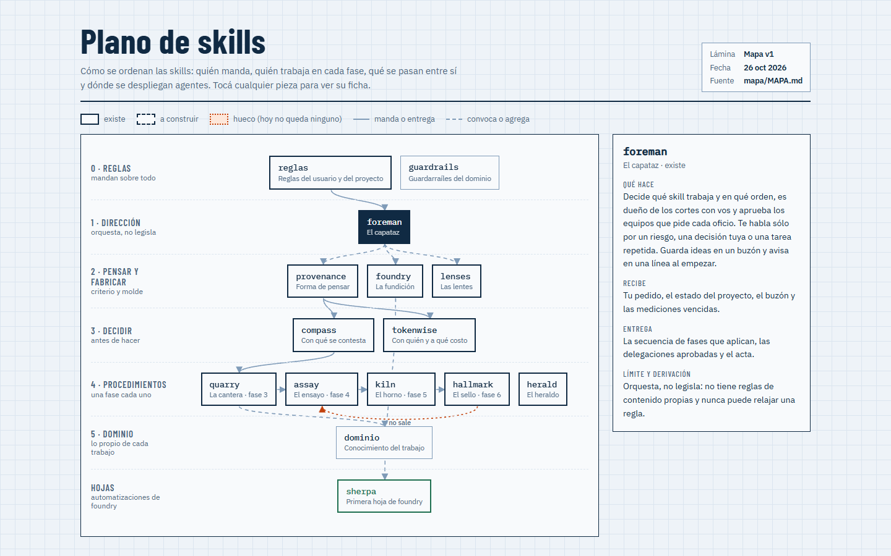
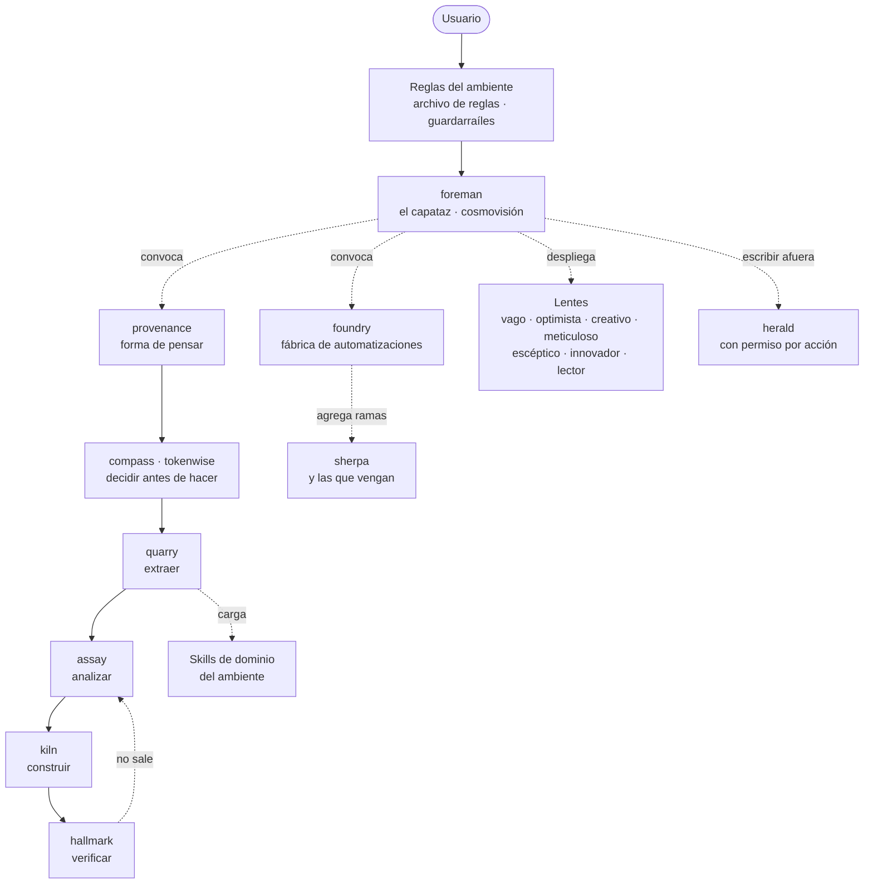
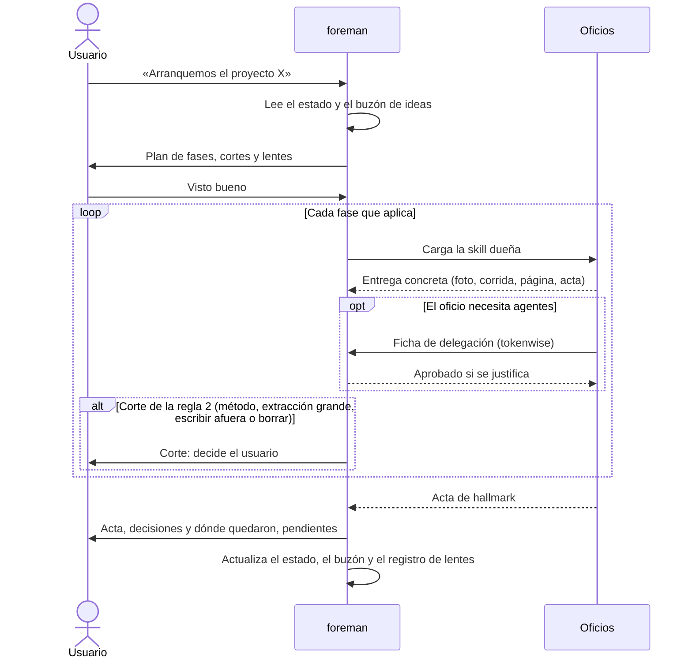

# Guild

**Un gremio de skills para trabajar en cualquier proyecto, con cualquier IA.** Cada skill es un oficio con su
procedimiento, sus reglas y sus herramientas; un capataz decide quién entra y cuándo; y cada entrega sale con un sello
que dice qué se verificó. Lo que viaja de un trabajo a otro es **la estructura de trabajo**, no las herramientas de un
lugar ni una plataforma.

> Se llama al capataz, `foreman`, al empezar un proyecto. Él lee el pedido, arma el plan de fases con el oficio dueño
> de cada una, consulta al usuario sólo en las decisiones que son suyas y cierra con un acta.

[](mapa/mapa.html)

<sub>El plano interactivo es [`mapa/mapa.html`](mapa/mapa.html): descargalo y abrilo en el navegador para tocar cada
pieza y ver su ficha (GitHub muestra el código, no la página).</sub>

---

## En una mirada



**La cadena del taller:** `quarry` saca el mineral, `assay` lo ensaya, `kiln` lo cuece y `hallmark` le pone el sello.
`foundry` hace el molde cuando algo se repite; `foreman` coordina todo.

## Cómo funciona



No toda tarea recorre todas las fases. Un análisis que sostiene una decisión recorre las siete; una página sin cifras,
sólo plantear, construir y la lectura final; una consulta rápida se contesta directo. La tabla completa está en
[`foreman/referencias/ciclo.md`](foreman/referencias/ciclo.md).

## El marco: de la cosmovisión a la técnica

| Nivel | Pregunta | Oficio |
|---|---|---|
| Cosmovisión | ¿Para qué trabajamos y qué es un buen trabajo? | `foreman` |
| Gnoseología | ¿De dónde sale lo que sabemos? | `quarry`, las skills de dominio, los axiomas de origen de `provenance` |
| Epistemología | ¿Cuándo algo está probado y con qué nivel? | `provenance`, `hallmark` |
| Metodología | ¿Por qué camino vamos? | El ciclo, `compass`, `tokenwise`, `lenses`, `foundry` |
| Técnica | ¿Con qué instrumento? | Los scripts y los procedimientos: `assay`, `kiln`, `sherpa` |

## Los oficios

| Skill | Nivel | Qué hace | Herramientas |
|---|---|---|---|
| [`foreman`](foreman/SKILL.md) | Dirección | Arranca, retoma y cierra proyectos. Arma el plan de fases, despliega las lentes, cierra con un acta y lleva el buzón de ideas. **Orquesta, no legisla.** | Ciclo y lentes en `referencias/` |
| [`provenance`](provenance/SKILL.md) | Forma de pensar | El origen y la naturaleza de cada cifra, el nivel de cada conclusión, validar contra la propia ilusión. | — |
| [`compass`](compass/SKILL.md) | Decidir | Elige la técnica o herramienta para una pregunta y dice cuándo no conviene. | Catálogo de técnicas |
| [`tokenwise`](tokenwise/SKILL.md) | Decidir | La ficha de delegación: cada oficio pide el equipo que necesita y se aprueba lo que se justifica por costo y beneficio, sin topes fijos. Cómo se escribe el encargo. | — |
| [`lenses`](lenses/SKILL.md) | Pensar distinto | Las siete lentes: proponen por separado en puntos fijos, con su registro. | — |
| [`quarry`](quarry/SKILL.md) | Fase: extraer | Saca datos de cualquier origen sin romper la fuente: estimar, muestra, foto con ficha, perfil al llegar. Dueña de los conectores: que cada cuenta sea la del usuario. | `ficha.py`, `perfil.py`, `tablas.py` |
| [`assay`](assay/SKILL.md) | Fase: analizar | Plan antes de ver resultados, pre-análisis, cálculo en corridas reproducibles, todos los intentos contados. | `corrida.py` |
| [`kiln`](kiln/SKILL.md) | Fase: construir | Cualquier entregable pulido desde el primer intento: páginas y tableros, y también documentos, planillas y presentaciones. Se mira antes de mostrar. | `foto_pagina.py` |
| [`hallmark`](hallmark/SKILL.md) | Fase: verificar | Cada cifra del entregable buscada en las salidas, identidades que cierran, lectura final y acta. Dueña del contrato de los auditores: cada oficio pide el suyo, especializado, y se audita contra lo pedido y contra el oficio. | `cifras.py` |
| [`herald`](herald/SKILL.md) | Escribir afuera | Responder, publicar, cambiar un estado o borrar, siempre con vista previa exacta, aprobación por acción, registro y cómo deshacer. | — |
| [`foundry`](foundry/SKILL.md) | Fábrica | Convierte una tarea repetida en una automatización: relevar, calcular si vale la pena, lentes, opciones y registro con predicción. | — |
| [`sherpa`](sherpa/SKILL.md) | Automatización | Resumen de inicio de jornada con las fuentes que el usuario conecte (chat, correo, calendario u otras), en una sola línea de tiempo y con un lector por fuente. Sólo lectura. Primera rama de `foundry`. | — |

Todos los scripts usan la biblioteca estándar de Python (más `openpyxl` para `.xlsx`, y Chrome con `websockets` para
las capturas de `kiln`).

**Las lentes** (vago, optimista, creativo, meticuloso, escéptico, innovador y lector) son siete maneras de pensar que
sacan el trabajo de su zona de confort. Sus contratos y dónde se despliegan están en [`lenses`](lenses/SKILL.md).

## Principios

1. **Un dueño por regla.** Cada regla vive en una sola skill; las demás la nombran.
2. **Orquestar no es legislar.** `foreman` decide quién trabaja y cuándo, nunca relaja una regla.
3. **Las decisiones de método son del usuario.** Hay cortes fijos que ningún oficio se saltea.
4. **Confiar con constancia, no con promesas.** Cada entrega trae su acta: qué se verificó, qué no y qué riesgo queda.
5. **Núcleo portable.** Las skills no nombran empresas, sistemas, personas ni plataformas. Lo propio de cada trabajo va
   en la configuración del ambiente; lo propio de cada IA, en su adaptador.
6. **El círculo expansivo.** Cada vuelta deja algo que mejora la siguiente. El sistema propone sus mejoras; el usuario
   las aprueba.

## Usarlo con cualquier IA

El núcleo es texto (Markdown) y Python. Lo que cambia entre plataformas es cómo se cargan los oficios, dónde viven las
reglas, qué pasa al abrir una sesión, cómo se lanzan agentes y rutinas y cómo se conectan las fuentes del usuario. Eso
lo resuelve un **adaptador**, que cumple el contrato de [`mapa/MAPA.md`](mapa/MAPA.md) §6.

| Plataforma | Cómo empezar | Estado |
|---|---|---|
| Claude Code y claude.ai | [`adaptadores/claude-code.md`](adaptadores/claude-code.md): clonar en `~/.claude/skills`, plugins o ZIP | En uso (el hook y la rutina, sin probar) |
| Cualquiera que lea `AGENTS.md` (Cursor, Codex y otras) | Abrir el repositorio o apuntar las reglas a [`AGENTS.md`](AGENTS.md), el índice de oficios | Escrito, sin probar |
| Bot en servidor propio (Grok Bot) | [`adaptadores/grok-bot.md`](adaptadores/grok-bot.md): perfil o memoria, skills o [`AGENTS.md`](AGENTS.md), `Task` y `UpdateRoutine` | Diseñado y documentado, sin probar |

Instalación rápida en Claude Code:

```bash
git clone https://github.com/joacom369/guild.git ~/.claude/skills
```

El repositorio es privado: hace falta acceso con una cuenta de GitHub que tenga permiso.

<details>
<summary>Instalar como plugins de Claude Code (2.1.275 o posterior)</summary>

```
/plugin install foreman --marketplace joacom369/guild
/plugin install provenance --marketplace joacom369/guild
/plugin install compass --marketplace joacom369/guild
/plugin install tokenwise --marketplace joacom369/guild
/plugin install lenses --marketplace joacom369/guild
/plugin install herald --marketplace joacom369/guild
/plugin install quarry --marketplace joacom369/guild
/plugin install assay --marketplace joacom369/guild
/plugin install kiln --marketplace joacom369/guild
/plugin install hallmark --marketplace joacom369/guild
/plugin install foundry --marketplace joacom369/guild
/plugin install sherpa --marketplace joacom369/guild
/plugin install impeccable --marketplace joacom369/guild
/plugin install design-taste-frontend --marketplace joacom369/guild
```

En versiones anteriores: `/plugin marketplace add joacom369/guild` y después `/plugin install <skill>@guild`.
</details>

## Configurar un ambiente nuevo

1. **El archivo de reglas** de la plataforma (`CLAUDE.md`, `AGENTS.md` u otro): las reglas del trabajo, por ejemplo
   qué sistemas son de sólo lectura, el idioma y cuándo llamar a cada oficio.
2. **Skills de dominio** del trabajo, si existen: el vocabulario, qué fuente es la verdad para cada dato y cómo se
   accede a cada sistema.
3. **La configuración de los oficios que la necesitan**, fuera de este repositorio:
   - [`foreman/referencias/ambiente-ejemplo.md`](foreman/referencias/ambiente-ejemplo.md): el modo por defecto, los
     proyectos, el buzón y el registro de lentes;
   - [`sherpa/referencias/ambiente-ejemplo.md`](sherpa/referencias/ambiente-ejemplo.md): los conectores verificados,
     los grupos con su ID, el horario, el tope y qué es urgente.
4. **Los conectores** con la cuenta del usuario: [`quarry/referencias/conectores.md`](quarry/referencias/conectores.md).

## Estructura del repositorio

```
guild/
├── AGENTS.md                                    índice de oficios para cualquier IA
├── foreman/ provenance/ lenses/                 dirección, forma de pensar, lentes
├── compass/ tokenwise/                          decidir
├── quarry/ assay/ kiln/ hallmark/ herald/       la cadena del taller y la escritura afuera
├── foundry/ sherpa/                             fábrica y sus ramas
│   └── <skill>/
│       ├── SKILL.md                             el oficio
│       ├── referencias/                         el detalle que se carga cuando hace falta
│       ├── scripts/                             las herramientas
│       └── evals/                               pruebas de disparo (no van en los ZIP)
├── impeccable/ design-taste-frontend/           de terceros, sin modificar
├── mapa/                                        MAPA.md, plano interactivo y documentos históricos
├── adaptadores/                                 lo propio de cada plataforma, y ejemplos reutilizables
├── docs/                                        imágenes del README
├── dist/                                        ZIP por skill para claude.ai
├── .claude-plugin/marketplace.json              catálogo de plugins (adaptador de Claude Code)
├── empaquetar.py                                arma los ZIP y controla las descriptions
└── LICENSE
```

## Cómo se prueba

| Control | Qué mira | Cómo se corre |
|---|---|---|
| Validación | El catálogo y los manifiestos | `claude plugin validate .` |
| Descriptions | Que ninguna rompa el YAML (un error que la validación no ve) | `python empaquetar.py` |
| Disparo | Que cada skill se cargue cuando debe y no cuando no: 4 o 5 casos por skill, la mitad que deben disparar y la otra mitad parecidos que no | `claude plugin eval <skill> --ablation none --runs 3 --model sonnet --trust-plugin` |
| Piso de disparo | Que la description y los casos sean los medidos y ninguna tasa caiga más de un fallo; el piso sólo sube ([regla](foundry/referencias/escribir-skills.md)) | `python empaquetar.py` lo controla; `python empaquetar.py --piso <skill>` lo sube |
| Auditoría del gremio | Caso negativo, solapes de momento, reglas casi iguales, piso presente, dueños e índice. El ciclo está en [el harness](foundry/referencias/harness-autoauditoria.md) | `python foundry/scripts/auditar_gremio.py` |
| Scripts | Cada uno se probó con datos sembrados con fallas conocidas | Ver `mapa/MAPA.md` |
| Plano | Que la página no tenga errores ni desborde en celular | `python kiln/scripts/foto_pagina.py file:///<ruta>/mapa/mapa.html <prefijo>` |

## Mantener

Editar la skill (con la guía [`foundry/referencias/escribir-skills.md`](foundry/referencias/escribir-skills.md)) → `python foundry/scripts/auditar_gremio.py` → `python empaquetar.py` → `claude plugin validate .` → si cambió una description, correr sus pruebas
de disparo y subir el piso (`python empaquetar.py --piso <skill>`) → si cambió el mapa, actualizar `mapa.html` y la captura `docs/mapa.png` → commit y push.

## Licencia

Lo propio de este repositorio va bajo licencia **MIT** ([`LICENSE`](LICENSE)): se puede usar, cambiar y compartir
manteniendo el aviso de autoría.

### De terceros

Copias sin modificar, cada una con su licencia dentro de la carpeta. Para actualizarlas, reemplazar la carpeta entera
por la versión nueva, con su `LICENSE` y su `NOTICE`.

| Skill | Autor y licencia | Para qué |
|---|---|---|
| `impeccable` | Paul Bakaus, Apache 2.0 ([`LICENSE`](impeccable/LICENSE), [`NOTICE`](impeccable/NOTICE.md)), github.com/pbakaus/impeccable, v4.5.0 | Diseñar, pulir y auditar interfaces |
| `design-taste-frontend` | Leonxlnx, MIT ([`LICENSE`](design-taste-frontend/LICENSE)). Versión archivada `design-taste-frontend-v2-experimental` de github.com/Leonxlnx/taste-skill-classics (commit 5e08c93); se invoca por su nombre | Dirección visual sin defaults de plantilla |
