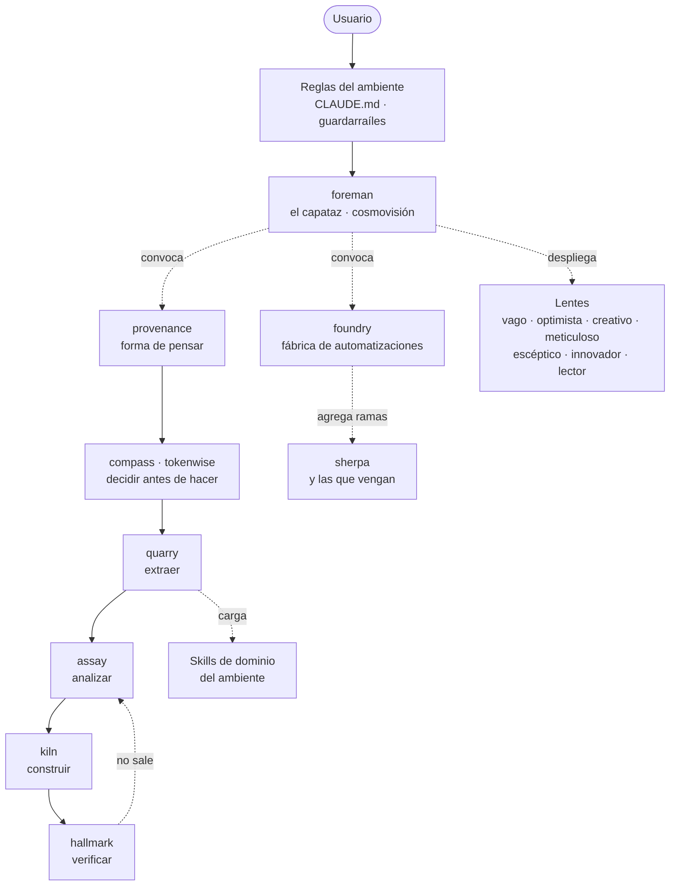
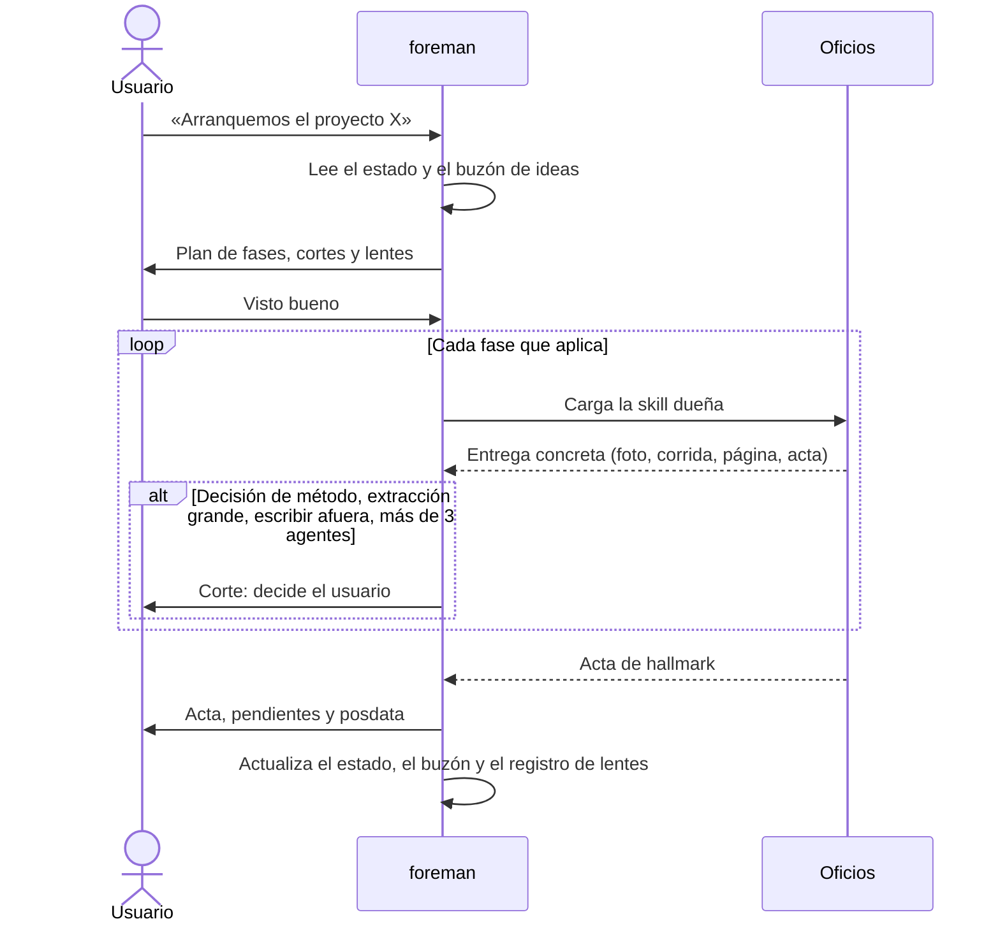

# Guild

**Un gremio de skills para trabajar en cualquier proyecto, con cualquier IA.** Cada skill es un oficio con su
procedimiento, sus reglas y sus herramientas; un capataz decide quién entra y cuándo; y cada entrega sale con un sello
que dice qué se verificó. Lo que viaja de un trabajo a otro es **la estructura de trabajo**, no las herramientas de un
lugar.

> Se llama al capataz, `foreman`, al empezar un proyecto. Él lee el pedido, arma el plan de fases con el oficio dueño
> de cada una, consulta al usuario sólo en las decisiones que son suyas y cierra con un acta.

---

## En una mirada



**La cadena del taller:** `quarry` saca el mineral, `assay` lo ensaya, `kiln` lo cuece y `hallmark` le pone el sello.
`foundry` hace el molde cuando algo se repite; `foreman` coordina todo.

## Cómo funciona



No toda tarea recorre todas las fases. Un análisis que sostiene una decisión recorre las siete; una página sin cifras,
sólo plantear, construir y la lectura final; una consulta rápida se contesta directo. La tabla completa está en
[`foreman/referencias/ciclo.md`](foreman/referencias/ciclo.md).

## El marco: de la cosmovisión a la técnica

| Nivel | Pregunta | Oficio |
|---|---|---|
| Cosmovisión | ¿Para qué trabajamos y qué es un buen trabajo? | `foreman` |
| Gnoseología | ¿De dónde sale lo que sabemos? | `quarry`, las skills de dominio, los axiomas de origen de `provenance` |
| Epistemología | ¿Cuándo algo está probado y con qué nivel? | `provenance`, `hallmark` |
| Metodología | ¿Por qué camino vamos? | El ciclo, `compass`, `tokenwise`, `foundry` |
| Técnica | ¿Con qué instrumento? | Los scripts y los procedimientos: `assay`, `kiln`, `sherpa` |

## Los oficios

| Skill | Nivel | Qué hace | Herramientas |
|---|---|---|---|
| [`foreman`](foreman/SKILL.md) | Dirección | Arranca, retoma y cierra proyectos. Arma el plan de fases, despliega las lentes, cierra con un acta y lleva el buzón de ideas. **Orquesta, no legisla.** | Ciclo y lentes en `referencias/` |
| [`provenance`](provenance/SKILL.md) | Forma de pensar | El origen y la naturaleza de cada cifra, el nivel de cada conclusión, validar contra la propia ilusión. | — |
| [`compass`](compass/SKILL.md) | Decidir | Elige la técnica o herramienta para una pregunta y dice cuándo no conviene. | Catálogo de técnicas |
| [`tokenwise`](tokenwise/SKILL.md) | Decidir | Si conviene repartir entre agentes, con qué modelo y cómo se escribe el encargo. | — |
| [`quarry`](quarry/SKILL.md) | Fase: extraer | Saca datos de cualquier origen sin romper la fuente: estimar, muestra, foto con ficha, perfil al llegar. | `ficha.py`, `perfil.py` |
| [`assay`](assay/SKILL.md) | Fase: analizar | Plan antes de ver resultados, pre-análisis, cálculo en corridas reproducibles, todos los intentos contados. | `corrida.py` |
| [`kiln`](kiln/SKILL.md) | Fase: construir | Páginas y tableros pulidos desde el primer intento, mirados en escritorio y celular. | `foto_pagina.py` |
| [`hallmark`](hallmark/SKILL.md) | Fase: verificar | Cada cifra del entregable buscada en las salidas, identidades que cierran, lectura final, revisión independiente y acta. | `cifras.py` |
| [`foundry`](foundry/SKILL.md) | Fábrica | Convierte una tarea repetida en una automatización: relevar, calcular si vale la pena, lentes, opciones y registro con predicción. | — |
| [`sherpa`](sherpa/SKILL.md) | Automatización | Resumen de inicio de jornada: chat y correo en urgente, pendiente, contexto y ruido. Sólo lectura. Primera rama de `foundry`. | — |

Todos los scripts usan la biblioteca estándar de Python (más `openpyxl` para `.xlsx`, y Chrome para las capturas de
`kiln`).

### Las lentes

Siete maneras de pensar que sacan el trabajo de su zona de confort. Cada una propone por separado y `foreman`
sintetiza. Algunas propuestas van a sobrar: es parte de aprender, y se registra cuál aportó qué.

| Vago | Optimista | Creativo | Meticuloso | Escéptico | Innovador | Lector |
|---|---|---|---|---|---|---|
| Lo mínimo que llega | El techo, rotulado | Caminos distintos | Qué se rompe | ¿Vale la pena? | Qué oficio ya lo resolvió | Cómo lo va a usar quien lo recibe |

## Principios

1. **Un dueño por regla.** Cada regla vive en una sola skill; las demás la nombran.
2. **Orquestar no es legislar.** `foreman` decide quién trabaja y cuándo, nunca relaja una regla.
3. **Las decisiones de método son del usuario.** Hay cortes fijos que ningún oficio se saltea.
4. **Confiar con constancia, no con promesas.** Cada entrega trae su acta: qué se verificó, qué no y qué riesgo queda.
5. **Núcleo portable.** Las skills no nombran empresas, sistemas ni personas. Lo propio de cada trabajo va en la
   configuración del ambiente.
6. **El círculo expansivo.** Cada vuelta deja algo que mejora la siguiente. El sistema propone sus mejoras; el usuario
   las aprueba.

## Instalar

### Claude Code

```
/plugin install foreman --marketplace joacom369/guild
/plugin install provenance --marketplace joacom369/guild
/plugin install compass --marketplace joacom369/guild
/plugin install tokenwise --marketplace joacom369/guild
/plugin install quarry --marketplace joacom369/guild
/plugin install assay --marketplace joacom369/guild
/plugin install kiln --marketplace joacom369/guild
/plugin install hallmark --marketplace joacom369/guild
/plugin install foundry --marketplace joacom369/guild
/plugin install sherpa --marketplace joacom369/guild
/plugin install impeccable --marketplace joacom369/guild
/plugin install design-taste-frontend --marketplace joacom369/guild
```

En versiones anteriores a la 2.1.275: `/plugin marketplace add joacom369/guild` y después
`/plugin install <skill>@guild`. El repositorio es privado: la PC necesita acceso a GitHub con la cuenta (por ejemplo,
`gh auth login`).

### Clonando (recomendado para quien lo mantiene)

```bash
git clone https://github.com/joacom369/guild.git ~/.claude/skills
```

Si `~/.claude/skills` ya existe, clonar aparte y copiar las carpetas.

### claude.ai

Descargar `dist/<skill>.zip` y subirlo en Configuración > Capacidades > Skills.

### Otras IA

Las skills son texto (Markdown) y los scripts son Python. Lo que depende de cada plataforma es cómo se cargan y cómo se
corren las tareas al abrir una sesión o con horario. Eso se resuelve con un adaptador por plataforma; el de Claude
Code ya existe y el de Cursor está pendiente.

## Configurar un ambiente nuevo

1. **CLAUDE.md** (o el archivo de reglas de la plataforma): las reglas del trabajo. Por ejemplo, qué sistemas son de
   sólo lectura, el idioma y cuándo llamar a cada oficio.
2. **Skills de dominio** del trabajo, si existen: el vocabulario, qué fuente es la verdad para cada dato y cómo se
   accede a cada sistema.
3. **Configuración de los oficios que la necesitan**, fuera de este repositorio:
   - `foreman/referencias/ambiente-ejemplo.md`: el modo por defecto, el buzón y el registro de lentes;
   - `sherpa/referencias/ambiente-ejemplo.md`: el chat, el correo, el horario y qué es urgente.

## Estructura del repositorio

```
guild/
├── foreman/ provenance/ compass/ tokenwise/     dirección, forma de pensar, decidir
├── quarry/ assay/ kiln/ hallmark/               la cadena del taller
├── foundry/ sherpa/                             fábrica y sus ramas
│   └── <skill>/
│       ├── SKILL.md                             el oficio
│       ├── referencias/                         el detalle que se carga cuando hace falta
│       ├── scripts/                             las herramientas
│       └── evals/                               pruebas de disparo (no van en los ZIP)
├── impeccable/ design-taste-frontend/           de terceros, sin modificar
├── mapa/                                        MAPA.md, plano visual, auditoría, registro de automatizaciones
├── dist/                                        ZIP por skill para claude.ai
├── .claude-plugin/marketplace.json              catálogo de plugins
└── empaquetar.py                                arma los ZIP y controla las descriptions
```

El mapa completo (capas, contratos entre fases, un dueño por regla, dónde se despliegan agentes) está en
[`mapa/MAPA.md`](mapa/MAPA.md), con un plano interactivo en [`mapa/mapa.html`](mapa/mapa.html).

## Cómo se prueba

| Control | Qué mira | Cómo se corre |
|---|---|---|
| Validación | El catálogo y los manifiestos | `claude plugin validate .` |
| Descriptions | Que ninguna rompa el YAML (un error que la validación no ve) | `python empaquetar.py` |
| Disparo | Que cada skill se cargue cuando debe y no cuando no: 4 casos por skill, 2 que deben disparar y 2 parecidos que no | `claude plugin eval <skill> --ablation none --runs 1 --model sonnet` |
| Scripts | Cada uno se probó con datos sembrados con fallas conocidas | Ver `mapa/MAPA.md` |

## Mantener

Editar la skill → `python empaquetar.py` → `claude plugin validate .` → si cambió una description, correr sus pruebas
de disparo → commit y push.

## De terceros

Copias sin modificar, cada una con su licencia. Para actualizarlas, reemplazar la carpeta entera por la versión nueva.

| Skill | Autor y licencia | Para qué |
|---|---|---|
| `impeccable` | Paul Bakaus, Apache 2.0 (github.com/pbakaus/impeccable), v4.5.0 | Diseñar, pulir y auditar interfaces |
| `design-taste-frontend` | Leonxlnx (taste-skill), MIT | Dirección visual sin defaults de plantilla |
