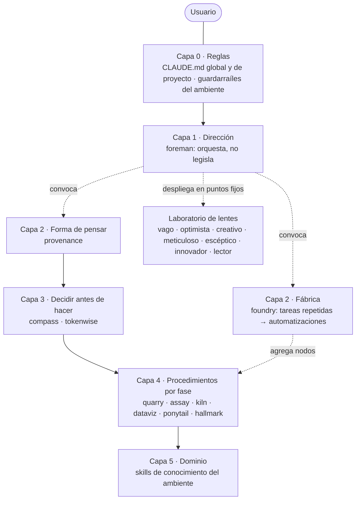
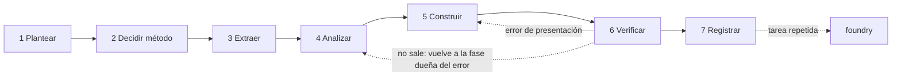

# Mapa de skills · v1 (estructura objetivo)

Fecha: 2026-10-25. Reemplaza a la v0. Se armó con la auditoría ([AUDITORIA.md](AUDITORIA.md)) y las decisiones sobre el
cerebro ([CEREBRO.md](CEREBRO.md)). Marcas:
- **(existe)**: ya está construido.
- **(a construir)**: está decidido, falta hacerlo.
- **(hueco)**: falta y no está decidido.

## 0. El marco: de la cosmovisión a la técnica

El sistema sigue la escala de la metodología de las ciencias. Cada nivel responde una pregunta distinta y se apoya en
el de arriba. Es lo que lo hace aplicable a cualquier proyecto, con cualquier IA: lo que viaja es **la estructura de
trabajo**, no las herramientas de un lugar.

| Nivel | Pregunta que responde | Pieza del árbol |
|---|---|---|
| **Cosmovisión** | ¿Para qué trabajamos y qué es un buen trabajo? | `foreman`: el propósito, los valores y el despliegue. Al empezar un proyecto se lo llama y sabe qué hacer. Orienta, no legisla el contenido |
| **Gnoseología** | ¿De dónde sale lo que sabemos? | `quarry` y las skills de dominio (las fuentes), y los axiomas 1 y 2 de `provenance` (el origen de cada cifra; lo que falta no es cero) |
| **Epistemología** | ¿Cuándo algo está probado y con qué nivel? | `provenance` (validación, nivel de cada conclusión) y `hallmark` (el control que lo hace cumplir) |
| **Metodología** | ¿Por qué camino vamos? | El ciclo de siete fases, `compass` (con qué técnica), `tokenwise` (con quién y a qué costo) y `foundry` (el método para crear métodos nuevos) |
| **Técnica** | ¿Con qué instrumento? | Los procedimientos y sus scripts: `ficha.py`, `perfil.py`, `corrida.py`, `cifras.py`, `foto_pagina.py`; `assay`, `kiln`, `sherpa` |

**Las lentes son el pluralismo del método.** Sacan el trabajo de su zona de confort: discuten la bibliografía
habitual, traen herramientas de otros oficios y estiran el techo. Así el sistema no se acostumbra a lo que ya hace.
Rompen la rutina, no las reglas: el escéptico y el meticuloso están para que lo disruptivo también se pruebe.

**El círculo expansivo.** Cada vuelta deja algo que mejora la siguiente:
- `foundry` registra qué se automatizó, con una predicción que después se mide;
- `foreman` anota qué lente aportó qué;
- `provenance` guarda las lecciones de método;
- las pruebas de disparo dicen qué skill falla en el momento de cargarse.

Con eso el sistema **propone** sus propias mejoras. Las aplica cuando el usuario las aprueba: las decisiones siguen
siendo suyas.

**Confiar sin revisar todo.** El objetivo es que el usuario no tenga que controlar cada cosa. Eso no se logra
prometiendo que todo sale bien: se logra con **controles que se corren solos y dejan constancia**. Cada entrega trae
su acta (`hallmark`): qué se verificó, qué no y qué riesgo queda. Cuando el sistema no está seguro, lo dice arriba de
todo. El usuario lee el acta en lugar de rehacer el trabajo, y la confianza crece a medida que las predicciones se
cumplen.

## 1. El árbol (eje vertical: quién manda sobre quién)

| Capa | Pieza | Qué decide | Estado |
|---|---|---|---|
| 0 · Reglas | CLAUDE.md y los guardarraíles del ambiente | Lo que no se negocia: idioma, las decisiones de método son del usuario, qué sistemas son de sólo lectura. *Ambiente actual (IG): `ig-guardrails`* | existe |
| 1 · Dirección | `foreman` | Qué skill trabaja, en qué orden, cuándo se despliega una lente, cuándo se le habla al usuario. **Orquesta, no legisla:** no tiene reglas de contenido propias | a construir |
| 2 · Forma de pensar | `provenance` | Qué es cada cifra, con qué nivel se concluye, cómo se valida | existe (a achicar) |
| 2 · Fábrica | `foundry` | Si una tarea repetida se automatiza y con qué escalón | existe (2026-10-25) |
| 3 · Decidir | `compass`, `tokenwise` | Con qué técnica o herramienta; con cuántos agentes y a qué costo | existe |
| 4 · Procedimientos | `quarry`, `assay`, `kiln` (+`impeccable`, `design-taste-frontend`), `dataviz`, `ponytail`, `hallmark` | Los pasos de cada fase, con scripts que fallan | existe |
| 5 · Dominio | Las skills de conocimiento de cada trabajo. *Ambiente actual (IG): `ig-knowledge:*`, `sales:*`, `octopuskg-guide`* | El conocimiento del negocio y de sus sistemas | depende del ambiente |

**Regla de precedencia (sólo para reglas de contenido):** las reglas del usuario (capa 0) mandan sobre todo. Entre
las capas 2 a 4, una más alta manda sobre una más baja cuando chocan. Una regla de dominio le gana a una general sólo
en su tema (por ejemplo, cómo se identifica un pedido en los sistemas de esa empresa). `foreman` queda fuera de esta cadena: decide quién trabaja y
cuándo, y **nunca puede relajar una regla** de las capas 0 a 5.

## 2. El ciclo (eje horizontal: las fases de un trabajo y sus contratos)

Cada fase tiene **un dueño**, recibe algo concreto y entrega algo concreto. Una fase que aplica no arranca sin la
entrega de la anterior. Esto es lo que evita que las skills se pisen.

**No toda tarea recorre las siete fases.** `foreman` elige las que aplican:

| Tipo de tarea | Fases | Ejemplo |
|---|---|---|
| Análisis con cifras que sostienen una decisión | 1 a 7 | Evaluación de una inversión, informe de ventas |
| Página o tablero sin cifras propias | 1, 5 y la lectura de la 6 | Landing, rediseño |
| Página o tablero con cifras | 1, 2 (¿hace falta?), 3 si hay que sacar datos, 5, 6 completa | Tablero comercial |
| Cambio de código | `ponytail` + las pruebas del proyecto | Arreglar un error |
| Consulta rápida | Se contesta directo | Una definición, un dato puntual con su fuente |
| Tarea repetida | `foundry` | «Todas las semanas armo este reporte» |

Si `hallmark` dice «no sale», el trabajo vuelve a la fase dueña del error, no siempre al análisis: una cifra mal
calculada vuelve a la 4 y un texto mal copiado, a la 5.

| Fase | Dueño | Recibe | Entrega | Punto de corte con el usuario |
|---|---|---|---|---|
| 1 Plantear | `provenance` | El pedido | Pregunta de análisis, alcance (describe / explica / evalúa), qué es variable, parámetro o supuesto | Si la lectura del pedido cambia lo que se hace |
| 2 Decidir método | `compass` + `tokenwise` | La pregunta | Veredicto de técnica («aplica / no aplica / todavía no») y plan de trabajo con costo | Siempre: el método lo decide el usuario |
| 3 Extraer | `quarry` | Qué datos y de dónde | Carpeta con foto, `FICHA.json` y perfil | Antes de una extracción grande (consultas, peso, tiempo) |
| 4 Analizar | `assay` (con los axiomas de `provenance`) | Foto verificada y veredicto de `compass` | Carpeta de corrida con `CORRIDA.json`, intentos contados | Si un supuesto cae o el diagnóstico falla |
| 5 Construir | `kiln` · `dataviz` · `ponytail` | Las salidas | El entregable (página, informe, planilla) | En la dirección visual (kiln paso 2) |
| 6 Verificar | `hallmark` | Entregable + salidas | Acta: sale / sale con observaciones / no sale | Si no sale: entregar igual lo decide el usuario |
| 7 Registrar | `provenance` (plantillas) + `foreman` | Acta y decisiones | ESTADO.md actualizado y la entrega (conclusión, opciones, lo que no se sabe) | — |

Fuera del ciclo y sobre todas las fases, `foreman` abre la sesión (lee ESTADO.md y el buzón) y la cierra (actualiza
los dos). Eso cubre el hueco de «retomar un proyecto» que marcó la auditoría.

## 3. Un dueño por regla

Cada regla vive en un solo lugar. Los demás la nombran y apuntan al dueño, sin repetirla. Esta tabla es la que se
aplica al achicar las skills.

| Regla | Dueño | Los demás… |
|---|---|---|
| Vocabulario de la naturaleza de una cifra | `provenance` axioma 4 | la usan tal cual (kiln, hallmark, quarry) |
| Un dato ausente nunca es cero | `provenance` axioma 2 | `quarry/perfil.py` y `kiln` la aplican |
| Nivel de una conclusión (preliminar, definitivo, techo) | `provenance` axioma 3 | — |
| Validación de un modelo (fuera de muestra, benchmark, contar intentos) | Principio: `provenance` axioma 7. Procedimiento: `assay` | `compass` decide si la técnica aplica, no cómo se valida |
| Si una técnica o un tablero hace falta | `compass` | `kiln` lo consulta antes de su paso 2 |
| Repartir, modelo, costo, encargo a un agente | `tokenwise` | `hallmark` nivel 3 y `quarry` lo nombran |
| Extracción, foto, ficha, perfil | `quarry` | `tokenwise` §7 queda como puntero |
| Cifras contra salidas, identidades, lectura final, acta, revisor independiente | `hallmark` | `provenance` deja el principio en una línea; `tokenwise` §4 apunta |
| Dirección visual y pulido de una página | `kiln` (+ compañeras) | — |
| Código mínimo | `ponytail` | — |
| ESTADO.md: formato | `provenance` (plantilla) | — |
| ESTADO.md: cuándo se lee y se escribe | `foreman` | — |
| Qué skill trabaja y cuándo | `foreman` (+ índice corto en CLAUDE.md) | las descriptions sólo dicen su momento, con caso negativo |
| Sistemas del ambiente: sólo lectura, verdad de cada fuente | CLAUDE.md + las skills de dominio (*ambiente actual: `ig-guardrails`, `ig-data-truth`*) | `quarry` las carga antes de extraer |

## 4. El laboratorio de lentes

**Aprobadas las siete (2026-10-25).** Las lentes están para abrir la cabeza: traen lo positivo o disruptivo de
maneras distintas de pensar. Algunas propuestas van a ser grandes y otras innecesarias, y eso es parte del proceso de
aprender. Por eso `foreman` anota qué lente aportó qué y qué terminó usándose; con el tiempo se ve cuáles rinden en
cada punto. Cada lente propone **por separado** y `foreman` sintetiza; no debaten entre ellas. Cada una entrega un
contrato concreto.

| Lente | Pregunta | Entrega | Se apoya en |
|---|---|---|---|
| **El vago** | ¿Qué es lo mínimo que llega al resultado? | La opción más barata y lo que se pierde con ella | `ponytail` |
| **El optimista** | ¿Y si sale todo bien y lo llevamos al máximo? | El techo, rotulado como techo, y qué tendría que ser cierto | `provenance` |
| **El creativo** | ¿De qué otras formas se puede resolver? | Tres o más opciones realmente distintas entre sí, no variantes de la misma | — |
| **El meticuloso** | ¿Qué se rompe y cómo nos enteramos? | Controles, casos límite, plan de verificación | `hallmark` |
| **El escéptico** | ¿Vale la pena? ¿Contra qué se compara? | Costo, contrafáctico, umbral de conveniencia | `provenance`, `compass` |
| **El innovador** | ¿Qué oficio ya resolvió esto? | Una herramienta o un método traído de otra disciplina, con los supuestos que trae | `provenance` («sustantivos a verbos») |
| **El lector** | ¿Cómo lo va a usar quien lo recibe? | Lo que va a entender mal o no va a poder usar | `kiln`, `hallmark` nivel 2 |

**El curioso** no es una lente: es `foreman` mismo, y lo que encuentra va al buzón.

**Dónde se despliegan** (sólo en puntos fijos y con el costo avisado):

| Punto | Lentes | Por qué ahí |
|---|---|---|
| `foundry` paso 4 (diseñar una automatización) | vago, optimista, escéptico, meticuloso | Es donde la tensión entre barato y ambicioso decide |
| Fase 2 en una decisión grande (método, inversión) | creativo, escéptico, optimista, innovador | Las opciones se ensanchan antes de cerrar |
| Fase 6 en una ronda grande | meticuloso (como revisor independiente), lector | Es el control antes de entregar |

## 5. Dónde se despliegan agentes

| Punto | Agente | Lo define | Estado |
|---|---|---|---|
| Investigar fuentes, precios, normas | Investigador liviano en segundo plano | `tokenwise` | existe |
| Extracción grande repartida | Uno por origen; devuelve archivos con ficha | `quarry` + `tokenwise` | existe |
| Pantallas aisladas | Agente en worktree | `tokenwise` | existe |
| Revisión antes de entregar | Revisor independiente fuerte | `hallmark` nivel 3 | existe |
| Puntos de decisión | Asesor (advisor) | `tokenwise` | existe |
| Lentes del laboratorio | Una lente por agente, en los puntos de la sección 4 | `foreman` | a construir |
| Detección de repeticiones | Revisión de las sesiones, previo permiso del usuario | `foreman` → `foundry` | a construir |
| Automatizaciones que salen de `foundry` | Según el escalón: subagente, workflow o rutina | `foundry` | a construir |

## 6. Núcleo y adaptadores

| Necesidad del núcleo | Claude Code | Cursor (con Grok) |
|---|---|---|
| Cargar un procedimiento a demanda | Skill (`SKILL.md`) | a verificar |
| Reglas que valen siempre | CLAUDE.md | a verificar (reglas del proyecto) |
| Algo que pasa sí o sí al abrir la sesión (avisar del buzón, leer ESTADO.md) | Hook `SessionStart` | a verificar |
| Agente con una tarea y sus herramientas | Subagente (`.claude/agents/`) | a verificar (agentes en la nube) |
| Varios agentes en un orden fijo con verificación | Workflow | a verificar |
| Correr solo, con horario | Rutina programada | a verificar |
| Pasos mecánicos | Scripts en Python | Scripts en Python (los mismos) |

**Patrones de portabilidad tomados del ambiente actual** (plugin de conocimiento de IG, visto el 2026-10-25; sirven en cualquier ambiente):
- El conocimiento vive en una base aparte (el bundle OKF, un concepto por archivo, con dueño y fecha). La skill sólo
  dice cómo leerlo. Es la misma división que hacemos entre núcleo y adaptador.
- En los bots de otras cuentas, el plugin no está en disco y se lee con Read por rutas relativas. El plugin registra
  que 9 de 9 lo lograron.
- *Ambiente actual:* las skills y los conectores de Grok Bot que compartió la empresa todavía no están accesibles;
  se suman al árbol cuando lo estén.

## 7. Huecos y orden de trabajo

**Huecos abiertos:**
1. ~~Fase 4 (analizar)~~ **resuelto (2026-10-25):** skill `assay`. Se llevó el protocolo de modelado de `compass`.
2. **Detección de repeticiones — decidido:** `foreman` pide permiso antes de mirar (qué va a leer y cuánto va a
   gastar). Con el visto bueno tiene vía libre para leer y proponer, pero **nunca modifica nada sin consentimiento**.
3. **Adaptador de Cursor:** verificar qué soporta hoy.

**Orden de trabajo:**
1. Aprobar este mapa.
2. ~~Ordenar lo existente según la sección 3~~ **hecho (2026-10-25):**
   - `provenance` pasó de 182 a 154 líneas (los hábitos en detalle fueron a `referencias/habitos.md`);
   - `tokenwise` pasó de 177 a 142 (el asesor fue a `referencias/asesor.md`);
   - las descriptions llevan su caso negativo;
   - los duplicados quedaron como punteros al dueño;
   - `quarry` carga las skills de dominio del ambiente antes de extraer.

   Quedan abiertos:
   - el protocolo de modelado de `compass` (insumo para decidir la fase 4);
   - `kiln/reference/` contra `referencias/`;
   - ~~los casos de IG nombrados en `compass`~~ (resuelto: ahora son genéricos).
3. Construir `foundry`.
4. Construir `foreman` (incluye el buzón y la apertura y el cierre de sesión).
5. ~~Pruebas de disparo~~ **hecho (2026-10-25):** 36 casos (4 por skill propia: 2 que deben disparar y 2 parecidos
   que no), con Sonnet y una corrida por caso. Primera vuelta: 34 de 36.
   - `sherpa` disparaba con «quiero automatizar mi revisión de Slack», que es de `foundry`. Se corrigió la description
     y pasó 3 de 3.
   - El caso de `tokenwise` estaba mal escrito: pedía «cuatro temas» sin decir cuáles. Se reescribió y pasó 3 de 3.
   - Se encontró que una description con «: » sin comillas rompe el YAML y `claude plugin validate` no lo detecta.
     Ahora lo controla `empaquetar.py`.

   Costo total: USD 2,32. Los casos están en `<skill>/evals/` y no van en los ZIP. Para repetirlos:
   `claude plugin eval <skill> --ablation none --runs 1 --model sonnet`.
6. Página visual del mapa.
7. Adaptador de Cursor.
