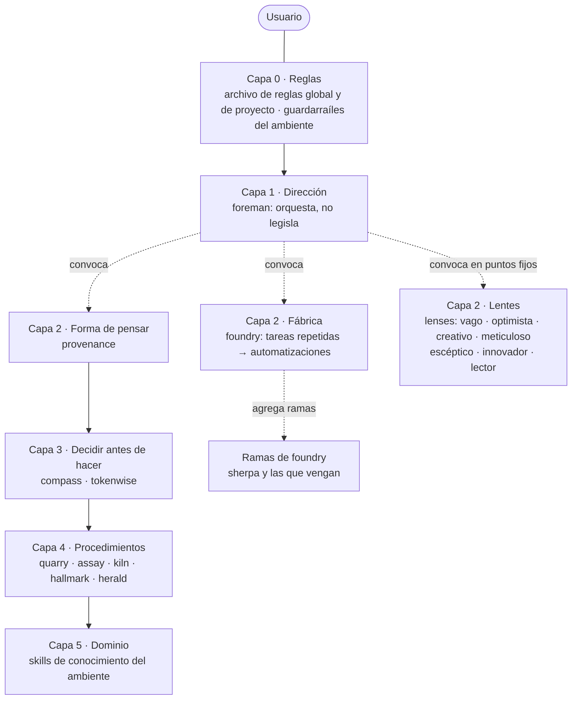
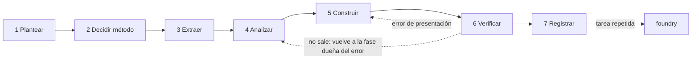

# Mapa de skills · v1 (estructura objetivo)

Fecha: 2026-10-25, actualizado el 2026-10-28 (adaptador de Grok Bot diseñado y documentado, sin probar; harness de
autoauditoría) y el 2026-11-23 (adaptador de Google Antigravity, parcialmente probado). Reemplaza a la v0. Se armó con la auditoría ([AUDITORIA.md](AUDITORIA.md)) y las decisiones sobre el
cerebro ([CEREBRO.md](CEREBRO.md)). Marcas:
- **(existe)**: ya está construido.
- **(a construir)**: está decidido, falta hacerlo.
- **(hueco)**: falta y no está decidido.

## 0. El marco: de la cosmovisión a la técnica

El sistema sigue la escala de la metodología de las ciencias. Cada nivel responde una pregunta distinta y se apoya en
el de arriba. Es lo que lo hace aplicable a cualquier proyecto, con cualquier IA: lo que viaja es **la estructura de
trabajo**, no las herramientas de un lugar.

| Nivel | Pregunta que responde | Pieza del árbol |
|---|---|---|
| **Cosmovisión** | ¿Para qué trabajamos y qué es un buen trabajo? | `foreman`: el propósito, los valores y el despliegue. Al empezar un proyecto se lo llama y sabe qué hacer. Orienta, no legisla el contenido |
| **Gnoseología** | ¿De dónde sale lo que sabemos? | `quarry` y las skills de dominio (las fuentes), y los axiomas 1 y 2 de `provenance` (el origen de cada cifra; lo que falta no es cero) |
| **Epistemología** | ¿Cuándo algo está probado y con qué nivel? | `provenance` (validación, nivel de cada conclusión) y `hallmark` (el control que lo hace cumplir) |
| **Metodología** | ¿Por qué camino vamos? | El ciclo de siete fases, `compass` (con qué técnica), `tokenwise` (con quién y a qué costo) y `foundry` (el método para crear métodos nuevos) |
| **Técnica** | ¿Con qué instrumento? | Los procedimientos y sus scripts: `ficha.py`, `perfil.py`, `corrida.py`, `cifras.py`, `foto_pagina.py`; `assay`, `kiln`, `sherpa` |

**Las lentes son el pluralismo del método.** Sacan el trabajo de su zona de confort: discuten la bibliografía
habitual, traen herramientas de otros oficios y estiran el techo. Así el sistema no se acostumbra a lo que ya hace.
Rompen la rutina, no las reglas: el escéptico y el meticuloso están para que lo disruptivo también se pruebe.

**El círculo expansivo.** Cada vuelta deja algo que mejora la siguiente:
- `foundry` registra qué se automatizó, con una predicción que después se mide;
- `foreman` anota qué lente aportó qué;
- `provenance` guarda las lecciones de método;
- las pruebas de disparo dicen qué skill falla en el momento de cargarse.

Con eso el sistema **propone** sus propias mejoras. Las aplica cuando el usuario las aprueba: las decisiones siguen
siendo suyas.

**Confiar sin revisar todo.** El objetivo es que el usuario no tenga que controlar cada cosa. Eso no se logra
prometiendo que todo sale bien: se logra con **controles que se corren solos y dejan constancia**. Cada entrega trae
su acta (`hallmark`): qué se verificó, qué no y qué riesgo queda. Cuando el sistema no está seguro, lo dice arriba de
todo. El usuario lee el acta en lugar de rehacer el trabajo, y la confianza crece a medida que las predicciones se
cumplen.

## 1. El árbol (eje vertical: quién manda sobre quién)

| Capa | Pieza | Qué decide | Estado |
|---|---|---|---|
| 0 · Reglas | El archivo de reglas del ambiente (CLAUDE.md, AGENTS.md o el de la plataforma) y sus guardarraíles | Lo que no se negocia: idioma, las decisiones de método son del usuario, qué sistemas son de sólo lectura | existe |
| 1 · Dirección | `foreman` | Qué skill trabaja y en qué orden, los cortes con el usuario, la aprobación de delegaciones, la configuración y los registros del ambiente. **Orquesta, no legisla:** no tiene reglas de contenido propias | existe |
| 2 · Forma de pensar | `provenance` | Qué es cada cifra, con qué nivel se concluye, cómo se valida | existe |
| 2 · Fábrica | `foundry` | Si una tarea repetida se automatiza y con qué escalón | existe |
| 2 · Lentes | `lenses` | Las siete maneras de pensar: contratos, puntos fijos, síntesis y registro | existe (2026-10-26) |
| 3 · Decidir | `compass`, `tokenwise` | Con qué técnica o herramienta; la ficha de delegación (el jefe pide, se aprueba lo que se justifica) | existe |
| 4 · Procedimientos | `quarry` (+ conectores), `assay`, `kiln` (cualquier entregable; +`impeccable`, `design-taste-frontend`, `dataviz`, las skills de archivos), `hallmark`, `herald` (escribir afuera con permiso); `ponytail` para el código | Los pasos de cada fase, con scripts que fallan | existe (`herald` desde 2026-10-26) |
| Ramas | `sherpa` (y las que fabrique `foundry`) | Automatizaciones con su predicción | existe |
| 5 · Dominio | Las skills de conocimiento de cada trabajo: vocabulario, sistemas, qué fuente es la verdad | El conocimiento del negocio y de sus sistemas | depende del ambiente |

**Regla de precedencia (sólo para reglas de contenido):** las reglas del usuario (capa 0) mandan sobre todo. Entre
las capas 2 a 4, una más alta manda sobre una más baja cuando chocan. Una regla de dominio le gana a una general sólo
en su tema (por ejemplo, cómo se identifica un pedido en los sistemas de esa empresa). `foreman` queda fuera de esta cadena: decide quién trabaja y
cuándo, y **nunca puede relajar una regla** de las capas 0 a 5.

## 2. El ciclo (eje horizontal: las fases de un trabajo y sus contratos)

Cada fase tiene **un dueño**, que puede trabajar con otros; recibe algo concreto y entrega algo concreto. Una fase
que aplica no arranca sin la entrega de la anterior. No toda tarea recorre las siete: `foreman` elige las que
aplican. La tabla de fases, la de tipos de tarea y los retornos son de `foreman`:
[`foreman/referencias/ciclo.md`](../foreman/referencias/ciclo.md). Acá no se copian.

Fuera del ciclo y sobre todas las fases, `foreman` abre la sesión (lee ESTADO.md, el buzón y las mediciones
vencidas) y la cierra (actualiza todo).

## 3. Un dueño por regla

Cada regla vive en un solo lugar. Los demás la nombran y apuntan al dueño, sin repetirla. Esta tabla es la que se
aplica al achicar las skills.

| Regla | Dueño | Los demás… |
|---|---|---|
| Vocabulario de la naturaleza de una cifra | `provenance` axioma 4 | la usan tal cual (kiln, hallmark, quarry) |
| Un dato ausente nunca es cero | `provenance` axioma 2 | `quarry/perfil.py` y `kiln` la aplican |
| Nivel de una conclusión (preliminar, definitivo, techo) | `provenance` axioma 3 | — |
| Validación de un modelo (fuera de muestra, benchmark, contar intentos) | Principio: `provenance` axioma 7. Procedimiento: `assay` | `compass` decide si la técnica aplica, no cómo se valida |
| Si una técnica o un tablero hace falta | `compass` | `kiln` lo consulta antes de su paso 2 |
| Repartir, modelo, costo, encargo a un agente | `tokenwise` | `hallmark` nivel 3 y `quarry` lo nombran |
| Extracción, foto, ficha, perfil | `quarry` | `tokenwise` §7 queda como puntero |
| Cifras contra salidas, identidades, lectura final, acta, revisor independiente | `hallmark` | `provenance` deja el principio en una línea; `tokenwise` §4 apunta |
| Dirección visual y pulido de una página | `kiln` (+ compañeras) | — |
| Código mínimo | `ponytail` | — |
| ESTADO.md: formato | `provenance` (plantilla) | — |
| ESTADO.md: cuándo se lee y se escribe | `foreman` | `provenance` lo nombra |
| Cortes con el usuario | `foreman` regla 2 | `AGENTS.md` y el README la nombran |
| Pedido de agentes y su aprobación | Ficha: `tokenwise` §2. Aprobación: `foreman` regla 3 | cada oficio pide con la ficha |
| Escribir afuera, borrar, archivar o pisar | `herald` | `foreman`, `sherpa` y `foundry` la llaman |
| Identidad y permiso de un conector | `quarry` (`referencias/conectores.md`) | `sherpa` la nombra |
| Configuración del ambiente y sus registros | `foreman` (`referencias/ambiente-ejemplo.md`) | cada oficio agrega su bloque |
| Lentes: contratos, puntos y registro | `lenses` | `foreman` y `foundry` la convocan |
| Contrato del auditor y catálogo por tipo de trabajo | `hallmark` (`referencias/revisor.md` y `auditores.md`) | cada oficio pide su auditor con la ficha de `tokenwise` |
| Cómo se escribe una skill o un índice | `foundry` (`referencias/escribir-skills.md`) | todos al editar |
| Piso de disparo (sólo sube) | Regla: `foundry` (`referencias/escribir-skills.md`). Control: `empaquetar.py` | el README lo nombra |
| Qué skill trabaja y cuándo | `foreman` (+ índice corto en el archivo de reglas; `AGENTS.md` en la raíz) | las descriptions sólo dicen su momento, con caso negativo |
| Sistemas del ambiente: sólo lectura, verdad de cada fuente | Las reglas del ambiente + sus skills de dominio | `quarry` las carga antes de extraer |
| Límites de concurrencia de una plataforma (cuántos agentes a la vez, qué herramienta es de a uno) | El adaptador de esa plataforma | `foreman` y `tokenwise` apuntan; no se copian |

## 4. El laboratorio de lentes

Dueña: la skill [`lenses`](../lenses/SKILL.md), con los contratos, los puntos fijos, la síntesis y el registro.
Acá no se copian.

**Aprobadas las siete (2026-10-25).** Las lentes están para abrir la cabeza: algunas propuestas van a ser grandes y
otras innecesarias, y eso es parte de aprender. **El curioso** no es una lente: es `foreman` mismo, y lo que
encuentra va al buzón.

## 5. Dónde se despliegan agentes

Cada fila es un **jefe** que pide su equipo con la ficha de `tokenwise`; dentro de un trabajo lo aprueba `foreman`.
No hay un número fijo de agentes.

| Punto | Agente | Lo define | Estado |
|---|---|---|---|
| Investigar fuentes, precios, normas | Investigador liviano en segundo plano | `tokenwise` | existe |
| Extracción grande repartida | Uno por origen; devuelve archivos con ficha | `quarry` + `tokenwise` | existe |
| Pantallas aisladas | Agente en worktree | `tokenwise` | existe |
| Auditoría de cada trabajo | Un auditor externo por oficio, especializado (código, cifras, interfaz, modelo, extracción, errores, seguridad) | `hallmark` (contrato y catálogo) | existe (2026-10-26) |
| Mirada cruzada final | Un auditor sobre el entregable completo, en rondas grandes | `hallmark` nivel 3 | existe |
| Puntos de decisión | Asesor (advisor) | `tokenwise` | existe |
| Lentes | Una lente por agente, en los puntos fijos de `lenses` | `lenses` | existe |
| Lectores de fuentes | Un lector por fuente; devuelve ítems normalizados, no resúmenes | `sherpa` | escrito, sin probar |
| Detección de repeticiones | Revisión de las sesiones, previo permiso del usuario | `foreman` → `foundry` | a construir |
| Automatizaciones que salen de `foundry` | Según el escalón: subagente, workflow o rutina | `foundry` | a construir |

## 6. Núcleo y adaptadores

Esta tabla es **el contrato del adaptador**: lo que cualquier plataforma tiene que darle al núcleo. Cada adaptador
dice cómo lo resuelve; el detalle está en [`adaptadores/`](../adaptadores/). En cada celda, «probado» es lo que se usó de verdad y «documentado» lo que está descrito pero no se usó.

| Necesidad del núcleo | Claude Code | Plataformas que leen `AGENTS.md` (Cursor, Codex y otras) | Bot en servidor propio (p. ej. Grok Bot) | Google Antigravity (2.0 / IDE / CLI) |
|---|---|---|---|---|
| Saber qué oficio cargar y cuándo | Descriptions de las skills + archivo de reglas (probado) | `AGENTS.md` (índice) | Descriptions si el Skill tool las carga; si no, `AGENTS.md` y el bloque del perfil (documentado) | Descriptions en `~/.gemini/config/skills/` (probado) + índice en `GEMINI.md` / `AGENTS.md` (documentado) |
| Cargar un procedimiento a demanda | Skill (`SKILL.md`) (probado) | Leer el `SKILL.md` por su ruta | Skill tool, o leer el `SKILL.md` por su ruta si el repo está (documentado) | Skill (`SKILL.md` y `referencias/`) en `~/.gemini/config/skills/` o `.agents/skills/` (probado) |
| Reglas que valen siempre | CLAUDE.md (probado) | `AGENTS.md` o las reglas del proyecto | Perfil y memoria del bot, más las skills de dominio. No usa `CLAUDE.md` (documentado) | `GEMINI.md` / `AGENTS.md` jerárquicos (24.000 bytes/archivo, 20.000 tokens agregados) (documentado) |
| Algo que pasa sí o sí al abrir la sesión (avisar del buzón, leer ESTADO.md) | Hook `SessionStart` (documentado, no instalado) | a verificar | No hay hook. Lo hace la primera respuesta, una `UpdateRoutine` o el mensaje de despertar (documentado) | `hooks.json` `SessionStart` (`type: "command"`, JSON camelCase; no instalado) (documentado) |
| Agente con una tarea y sus herramientas | Subagente (probado) | a verificar | `Task`: `executor`, `knowledgeWork`, `computerUse` (documentado) | `invoke_subagent` (4 alias) o `swarm` (23 IDs modelo+esfuerzo en 3 pools; `swarm models` probado, workers documentados) |
| Varios agentes en un orden fijo con verificación | Workflow (documentado) | a verificar | No hay workflow nativo. Se encadena el mismo `executor`; un fan-out pide permiso (documentado) | `run_workflow` (Python) o `swarm` con tablero compartido (documentado) |
| Correr solo, con horario | Rutina programada (documentado; la de `sherpa` falta) | a verificar | `UpdateRoutine` (cron o disparo de Slack, GitHub o correo); corre 24/7 (documentado) | `schedule` (`CronExpression` 5 campos + `IsDaemon: true`; timers con `DurationSeconds`) (documentado) |
| Conectores con la cuenta del usuario (chat, correo, calendario) | Conector por máquina o MCP local de lectura (probado) | a verificar | MCP de la cuenta del usuario; la identidad, con la receta de `quarry` (documentado) | `mcp_config.json` (global o plugin; `${X}` en `variables`) + verificación de identidad `quarry` (documentado) |
| Pasos mecánicos | Scripts en Python | Los mismos scripts | Los mismos scripts (documentado; no se corrieron en una box de bot) | Los mismos scripts Python (probado) |

**Patrones de portabilidad** (vistos en bases de conocimiento de empresa; sirven en cualquier ambiente):
- El conocimiento vive en una base aparte (un concepto por archivo, con dueño y fecha). La skill sólo dice cómo
  leerlo. Es la misma división que hacemos entre núcleo y adaptador.
- Donde la plataforma no instala las skills en disco, se leen por rutas relativas desde el repositorio.
- Los conectores de una cuenta compartida pueden ser de otra persona: cada fuente se verifica por separado
  (`quarry/referencias/conectores.md`).

## 7. Huecos y orden de trabajo

**Huecos abiertos:**
1. ~~Fase 4 (analizar)~~ **resuelto (2026-10-25):** skill `assay`. Se llevó el protocolo de modelado de `compass`.
2. **Detección de repeticiones — decidido:** `foreman` pide permiso antes de mirar (qué va a leer y cuánto va a
   gastar). Con el visto bueno tiene vía libre para leer y proponer, pero **nunca modifica nada sin consentimiento**.
3. **Adaptadores fuera de Claude Code:** `AGENTS.md` está escrito pero sin probar en Cursor ni en otra plataforma.
   El adaptador de Grok Bot está diseñado y documentado (2026-10-28), sin probar en un bot:
   [`adaptadores/grok-bot.md`](../adaptadores/grok-bot.md).
   El adaptador de Google Antigravity está diseñado y documentado (2026-11-23), con skills globales y lectura de cuotas probadas y el resto documentado:
   [`adaptadores/antigravity.md`](../adaptadores/antigravity.md).
4. **Bot propio y trabajo en vivo** (buzón, 2026-10-26). El adaptador de la plataforma quedó diseñado; sigue abierto
   lo que ese diseño no cubre:
   - probar el checklist de `adaptadores/grok-bot.md` en un bot de verdad;
   - un bot con nombre («sherpa») que mande el resumen al empezar la jornada, en lugar de un mensaje privado desde la
     cuenta del usuario;
   - la rutina de `sherpa` (`UpdateRoutine` en Grok Bot; en Claude Code sigue sin instalar);
   - el «cerebro de bots»: bots que detectan en vivo cuando se mueve algo (un mensaje, un correo, un estado) y lo
     resuelven o lo delegan en otro bot.

**Orden de trabajo:**
1. Aprobar este mapa.
2. ~~Ordenar lo existente según la sección 3~~ **hecho (2026-10-25):**
   - `provenance` pasó de 182 a 154 líneas (los hábitos en detalle fueron a `referencias/habitos.md`);
   - `tokenwise` pasó de 177 a 142 (el asesor fue a `referencias/asesor.md`);
   - las descriptions llevan su caso negativo;
   - los duplicados quedaron como punteros al dueño;
   - `quarry` carga las skills de dominio del ambiente antes de extraer.

   Quedan abiertos:
   - el protocolo de modelado de `compass` (insumo para decidir la fase 4);
   - `kiln/reference/` contra `referencias/`;
   - ~~los casos de una empresa nombrados en `compass`~~ (resuelto: ahora son genéricos).
3. ~~Construir `foundry`~~ **hecho (2026-10-25).**
4. ~~Construir `foreman`~~ **hecho (2026-10-25).** Falta el adaptador de inicio de sesión (hook), que es decisión del usuario.
5. ~~Pruebas de disparo~~ **hecho (2026-10-25):** 36 casos (4 por skill propia: 2 que deben disparar y 2 parecidos
   que no), con Sonnet y una corrida por caso. Primera vuelta: 34 de 36.
   - `sherpa` disparaba con «quiero automatizar mi revisión de Slack», que es de `foundry`. Se corrigió la description
     y pasó 3 de 3.
   - El caso de `tokenwise` estaba mal escrito: pedía «cuatro temas» sin decir cuáles. Se reescribió y pasó 3 de 3.
   - Se encontró que una description con «: » sin comillas rompe el YAML y `claude plugin validate` no lo detecta.
     Ahora lo controla `empaquetar.py`.

   - **Segunda vuelta, con `foreman` instalado (40 casos): 39 de 40.** `foreman` no le robó el momento a ninguna otra
     skill. `provenance` se cargaba con «guardá los datos con su procedencia» (3 de 3 veces): el nombre atrae. Se hizo
     explícito el caso negativo; pasó 3 de 3 y sus casos positivos siguen 2 de 2.

   Costo total de las dos vueltas: USD 4,45 (tope: USD 5). Los casos están en `<skill>/evals/` y no van en los ZIP. Para repetirlos:
   `claude plugin eval <skill> --ablation none --runs 1 --model sonnet`.
6. ~~Página visual del mapa~~ **hecho:** [`mapa.html`](mapa.html), con una captura en `docs/`.
7. **Adaptadores (2026-10-26):** contrato del adaptador (sección 6), `AGENTS.md` en la raíz y el adaptador de Claude
   Code en `adaptadores/`. Falta probar `AGENTS.md` en otra plataforma. El bot en servidor propio se diseñó el
   2026-10-28 (Grok Bot, documentado, sin probar).
8. **Primera prueba real de `sherpa` (2026-10-26):** chat, correo y calendario con la cuenta del usuario, entregado
   por mensaje privado. Lo aprendido quedó en la skill: identidad fuente por fuente, control positivo de menciones,
   una sola línea de tiempo y el bloque de calendario.
9. **Reestructuración (2026-10-26)** con cuatro propiedades (no redundancia, independencia, suficiencia, coherencia),
   tras una auditoría con revisor independiente:
   - oficios nuevos: `lenses` (salió de `foreman`) y `herald` (escribir afuera con permiso);
   - delegación: el jefe pide su equipo con la ficha de `tokenwise` y `foreman` aprueba lo que se justifica, sin
     topes fijos; al usuario se le avisa en una línea si el consumo es notable;
   - `sherpa` con fuentes enchufables y lectores por fuente; los conectores pasaron a `quarry`;
   - `kiln` construye cualquier entregable (la mecánica de los archivos es de las skills de archivos);
   - configuración y registros del ambiente con un solo dueño (`foreman`), fuera del repositorio;
   - el mapa apunta al dueño en lugar de copiar tablas.

   Pruebas de disparo de esta vuelta (`compass`, `sherpa`, `kiln` con un caso nuevo de presentación, y los 8 casos
   nuevos de `lenses` y `herald`): 25 de 25, USD 0,98.

   El registro de automatizaciones se mudó al ambiente (`~/.foreman/AUTOMATIZACIONES.md`): es propio de cada
   trabajo, no del núcleo. Quedan para después las repeticiones menores entre `provenance`, `hallmark`, `tokenwise` y `assay` sobre cómo se
   verifica.
10. **Dos ideas tomadas del `AGENTS.md` de storytold/photocraft (2026-10-27):**
    - `foreman` anota una línea por tramo en `ESTADO.md` (sección «Tramos» de la plantilla de `provenance`) y lo crea
      al terminar el primer tramo, no al cerrar: si la sesión se corta, queda desde dónde retomar.
    - Piso de disparo que sólo sube: `<skill>/evals/piso.json` y el control en `empaquetar.py`. El primer piso
      (todos los casos pasan en la última corrida) bloqueó por ruido: las pruebas son aleatorias. Quedó un piso de
      **tasas por caso**, medidas con 3 corridas o más y con huella de la description y de cada caso.
    - Piso **observado** (Sonnet, CLI 2.1.311): 12 skills, 50 casos. 48 casos al 100%; `assay/no-entrega` al 80%
      (5 corridas) y `provenance/si-razon` al 0% (3).
    - `provenance`: `si-concluir` fallaba (1 de 3) porque la description no cubría juzgar una conclusión ajena. Se
      reescribió el caso con los datos en el pedido y se agregó esa rama al principio de la description: 13 de 13.
      Pero la description usa la palabra del caso («se sostiene»), y `si-razon`, el mismo pedido con otra redacción
      («¿tiene razón?»), da 0 de 3. Sonnet contesta solo las preguntas causales fáciles. Queda como caso flojo
      conocido, en el piso con su 0%.
    - Lo que no se probó: cada suite carga sólo su skill, así que no se mide si una skill le roba el momento a otra
      cargada al mismo tiempo. `claude plugin eval` no trae una opción para cargar dos. El harness estático
      (`foundry/scripts/auditar_gremio.py`, 2026-10-28) marca solapes de palabras; no reemplaza esa prueba.
    - Costo de las pruebas del día: USD 8,6 (calculado con los `costUsd` de las corridas).
11. **Adaptador Grok Bot y harness (2026-10-28):** el adaptador está diseñado y documentado, sin probar en un bot.
    El harness se corrió en el repo (informe en [`AUDITORIA-ADAPTADOR-GROK.md`](AUDITORIA-ADAPTADOR-GROK.md)). El
    paso `--dinamico` propone mejoras comunes y puntuales a partir de los registros de trabajo; la autoprueba lo
    cubre con datos sembrados. No está instalada la rutina, no se leyeron sesiones reales y no se editó ninguna
    skill desde una propuesta. Sigue a mano decidir si un solape es un robo de momento de verdad, y probar el
    checklist del adaptador.
12. **Corrección automática (2026-10-28).** El ciclo de auditar y corregir corre solo y se detiene en los cortes.
    GitHub Actions (`.github/workflows/gremio.yml`) corre la autoprueba, `auditar_gremio.py --estricto` y
    `empaquetar.py` en cada pull request, en cada push a `main` y los lunes a las 09:00 (America/Buenos_Aires).
    `foundry/scripts/corregir_gremio.py` reescribe un enlace roto de la tabla de `AGENTS.md` sólo cuando el nombre
    de archivo es único, y sube ese cambio en un PR. No reescribe skills: una description cambiada para callar un
    aviso haría pasar el control sin medir el disparo. Un caso negativo ausente, un piso ausente o un dueño que no
    está dejan el check rojo. Los avisos no bloquean. No se creó una automatización en el dashboard de Cursor:
    el control que corre es Actions. La predicción, fuera del repo, es la fila de `~/.foreman/AUTOMATIZACIONES.md`
    con medición el 2026-11-25.
